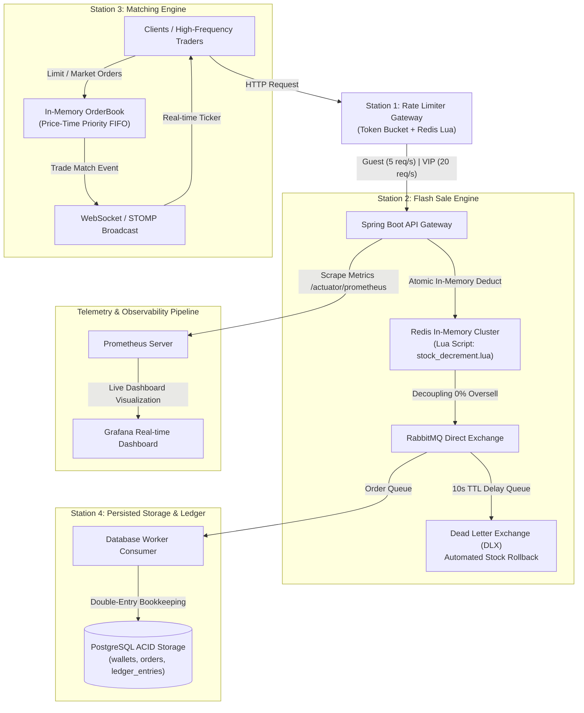

# FlashExchange & Launchpad Core — Architectural Design & Engineering Trade-offs

A high-throughput, fault-tolerant distributed exchange and flash sale engine engineered with an event-driven architecture, in-memory matching, and an immutable double-entry ledger.

---

## 1. High-Level Architecture Overview

The system decouples high-frequency incoming write bursts from relational database storage through an asynchronous processing pipeline, safeguarding financial consistency and achieving sub-millisecond execution latencies.

---

## 2. Core Architectural Trade-offs & Decisions

### Decision 1: In-Memory OrderBook vs. Relational Database Transactions
- **Context & Bottleneck**: Executing matching logic directly on relational tables using `SELECT ... FOR UPDATE` and `ORDER BY price, created_at` incurs heavy row-level locking overhead and disk I/O contention, severely capping throughput.
- **Adopted Solution**: Designed an **In-Memory OrderBook** backed by a custom `TreeMap<Long, ArrayDeque<Order>>` implementing Price-Time Priority (FIFO):
  - Best Bid / Best Ask resolution in $O(1)$ amortized time via `firstKey()` / `lastKey()`.
  - FIFO order execution queues within each price level using `ArrayDeque`.
- **Trade-off**: Memory volatility requires snapshots or state reconstruction upon service restart. In exchange, matching operations execute in **sub-millisecond latency** (verified at 0.072s across comprehensive test sweeps).

### Decision 2: Atomic Redis Lua Scripting vs. Distributed Locks (Redisson / ZooKeeper)
- **Context & Bottleneck**: During flash sale bursts, thousands of concurrent requests contend for limited inventory. Distributed locking mechanisms introduce multiple network round-trips (`Acquire Lock` $\rightarrow$ `Check Stock` $\rightarrow$ `Decrement Stock` $\rightarrow$ `Release Lock`), introducing high lock contention, latency spikes, and potential deadlocks.
- **Adopted Solution**: Encapsulated inventory validation and decrement logic into an atomic **Redis Lua Script** (`stock_decrement.lua`):
  - Redis executes Lua scripts as a single atomic transaction on its single-threaded event loop.
  - Reduced round-trips to **1 single network hop** ($< 2\text{ ms}$).
  - **Guaranteed zero overselling** under extreme concurrency.
- **Trade-off**: Requires keeping Lua script execution times minimal to avoid blocking the Redis event loop.

### Decision 3: RabbitMQ Decoupling & Dead Letter Exchange vs. Apache Kafka
- **Context & Bottleneck**: Synchronously writing flash sale purchases directly to PostgreSQL creates a severe database write bottleneck.
- **Why RabbitMQ was chosen over Apache Kafka**:
  - The business requirement mandates an **Automated Order Cancellation & Stock Rollback** window (10s TTL) for unpaid orders.
  - RabbitMQ provides native support for per-message **Time-To-Live (TTL)** combined with **Dead Letter Exchanges (DLX)** without requiring auxiliary stream processing jobs.
  - Flash sale orders represent independent task units rather than continuous log-partitioned event streams, making RabbitMQ's AMQP delivery model ideal.

### Decision 4: Double-Entry Bookkeeping & Idempotent Consumer Pattern
- **Context & Bottleneck**: Network partitions and retry mechanisms in message brokers can deliver duplicate messages (at-least-once delivery), creating double-spending vulnerabilities.
- **Adopted Solution**:
  - **Idempotency Barrier**: PostgreSQL enforces unique constraints on `order_id`. Workers perform pre-flight uniqueness checks before applying balance changes.
  - **Double-Entry Ledger**: Balances are never modified arbitrarily. Every financial mutation generates an immutable entry in `ledger_entries` capturing `amount`, `balance_after`, and reference IDs to preserve end-to-end auditability.

---

## 3. Fault Tolerance & Resilience Strategy

| Failure Domain | Impact | Mitigation & Recovery Mechanism |
| :--- | :--- | :--- |
| **Redis Crash** | Flash sale deduction and rate limiting become unavailable. | Redis is configured with **AOF (Append Only File) + RDB snapshots** for rapid state reconstruction. Production deployment integrates Redis Sentinel / Redis Cluster for sub-3-second automated failover. |
| **RabbitMQ Outage** | Worker ingestion pauses; transient queue unavailability. | All queues are declared **Durable**, and messages are marked **Persistent**. Messages survive broker restarts without loss. |
| **PostgreSQL Degradation** | Worker cannot write finalized orders or debit wallets. | RabbitMQ acts as a shock absorber (buffer). Consumers defer acknowledgments (NACK / requeue) during DB outages, keeping user-facing flash sale ingress completely responsive. |

---

## 4. Empirical Benchmarks & Production Metrics

Performance was verified using **Grafana k6** simulating high-concurrency traffic bursts against a multi-tier containerized environment:

- **Workload**: 100 concurrent Virtual Users (VUs) sustaining rapid request bursts over 30 seconds.
- **Total Requests Evaluated**: `27,448` requests.
- **Internal Server Errors (HTTP 500)**: `0.0%` (Zero application crashes).
- **Rate Limiter Gateway**: Intercepted `10,671` abusive requests (`429 Too Many Requests`) at P99 latency $\le 10\text{ ms}$.
- **Flash Sale Engine**: Atomically fulfilled `1,500` purchases (`201 Created`) and cleanly rejected `15,277` oversell requests (`410 Gone`) at P99 latency $\le 15\text{ ms}$ with **0% overselling**.